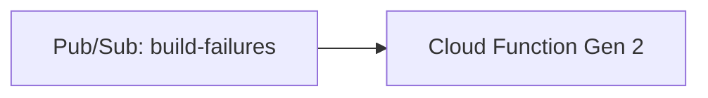

# Relatório Técnico — Exame Especial

**Aluno:** 256309 - Angelo Máximo Moreira Silva  
**Disciplina:** Serverless Computing e Arquiteturas Event-Driven  
**Professor:** André de Sousa Araújo  

---

## 1. Diagrama da Arquitetura Completa

> **TODO:** Insira abaixo o diagrama (em Mermaid ou ASCII/imagem) representando o fluxo completo:
> Publicação no tópico `build-failures` → Cloud Function Gen 2 (`triage-agent-event-driven`) → Verificação de Idempotência no Firestore → Loop ReAct com Vertex AI (Gemini + 3 Tools) → Secret Manager (`ONCALL_WEBHOOK_SECRET`) → Persistência no Firestore (`build_triages`) e caminho alternativo para a Dead-Letter Queue (`build-failures-dlq`).



---

## 2. Decisões de Resiliência, Idempotência e Segurança

### 2.1 Idempotência e Dead-Letter Queue (Etapa 1)
- **Como a idempotência foi implementada no Firestore:**  
  *(Descreva aqui como sua função evita chamadas duplicadas ao Gemini quando o Pub/Sub reentrega a mesma mensagem)*
- **Como a DLQ foi configurada no Terraform:**  
  *(Explique o papel do tópico `build-failures-dlq` e do `max_delivery_attempts`)*

### 2.2 Nova Ferramenta no Agente ReAct (Etapa 2)
- **Ferramenta adicionada e caso de uso (`build-303`):**  
  *(Explique os parâmetros da nova `FunctionDeclaration` e como o agente decide acioná-la)*

### 2.3 Menor Privilégio (IAM) e Secret Manager (Etapa 3)
- **Roles concedidas à Service Account `triage-agent-event-sa`:**  
  *(Liste as roles e explique por que seguem o princípio do menor privilégio)*
- **Uso do Secret Manager:**  
  *(Explique como o segredo `oncall-webhook-secret` é injetado sem expor credenciais no código)*

---

## 3. Observabilidade e Mitigação de Cold Start (Etapa 4)

- **Estrutura dos Logs JSON:**  
  *(Explique os campos incluídos em `log_structured` e como ajudam a filtrar um `build_id` no Cloud Logging)*
- **Boas práticas de Cold Start e Custos aplicadas:**  
  *(Explique o impacto do cliente global `_db_client`, `min_instance_count`, `max_instance_count` e memória configurados no `main.tf`)*

---

## 4. Evidências de Testes e Validação

> **TODO:** Cole abaixo a saída da execução dos seus testes unitários (`python3 -m unittest test_main.py -v`) e validação do Terraform (`terraform fmt` / `terraform validate`, ou logs do GCP caso tenha implantado na nuvem).

```text
Cole aqui o output dos testes executados
```
